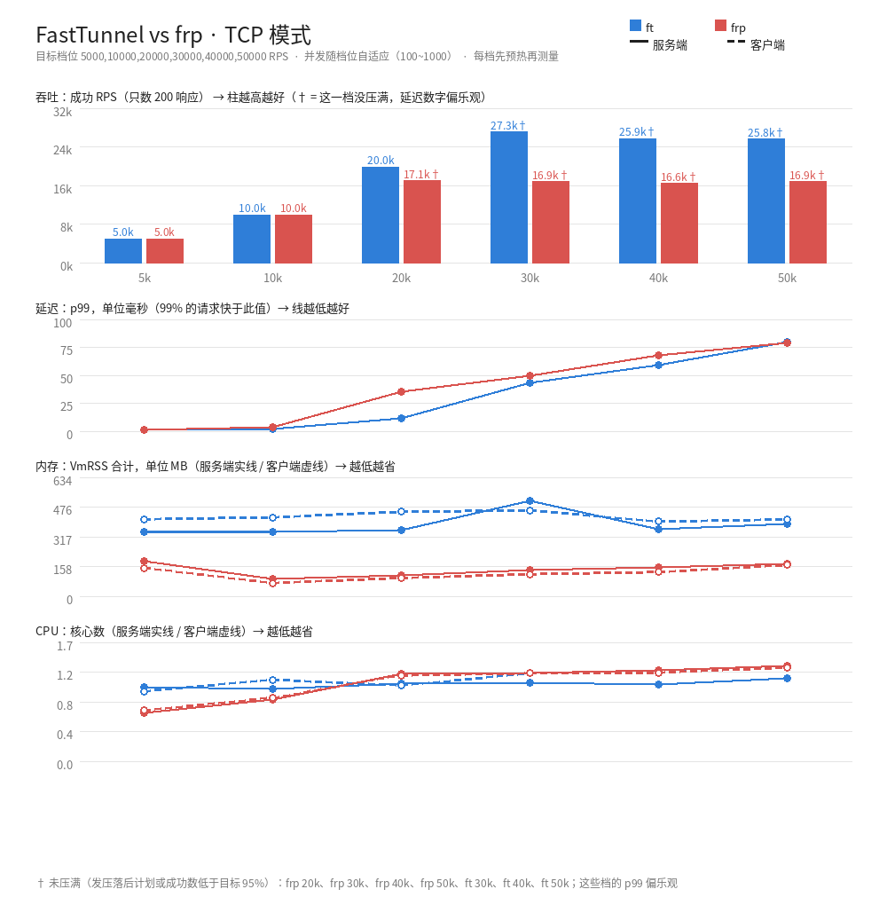

# fasttunnel-bench

Reproducible **HTTP tunneling benchmark**: FastTunnel vs [frp](https://github.com/fatedier/frp) 0.72.0,
same origin (IIS static page), same load generator, same machine.

可复现的**内网穿透性能对照基准**：FastTunnel 与 frp 0.72.0，同一源站、同一压测工具、同一台机器。

## Headline results / 主要结论

Single machine, loopback, IIS:8080 static 1KB page, 256 keep-alive connections, TLS off and logging off on both sides.
（单机 loopback，IIS:8080 静态页，256 并发 keep-alive，两侧关闭 TLS 与日志）

> ⚠ 下面两张表是 **2026-11-16 口径修订前** 的数据，读法见文末 [Metric revision](#metric-revision--口径修订2026-11-16)：
> 吞吐列含非 200 响应、frp 连接池实际被服务端夹在 5、TCP 行两侧代理方式不同层。

| Target | FastTunnel | frp `type=http` | frp `type=tcp` |
|---|---|---|---|
| 5 000 RPS | 4 999.6 · 0% err · p99 2.3ms | 4 999.2 · 0% · p99 17.9ms | 4 978 · 0% · p99 3.4ms |
| 10 000 RPS | **9 991.5 · 0% · p99 5.1ms** | 7 781.3 · 2.8% · p99 397ms | 9 953 · 0% · p99 12.8ms |
| generator ceiling¹ | **≈ 43 000 RPS** | — | ≈ 34 000 RPS |

¹ 固定 256 并发 + 闭环发压下的**发压上限**（256 ÷ ~6ms ≈ 43K），不是链路吞吐上限；两侧都受同一约束。

- Neither side errors out; beyond capacity they saturate (achieved stops tracking target, latency rises).
- frp's `type=http` (vhost) is the weak spot: at high concurrency it opens ~one work connection **per request**
  (debug log: 12 510 requests → 12 891 new work connections in 5s).
- frp's `type=tcp` is roughly on par with FastTunnel at 10K; its ceiling and memory efficiency are lower.
- frp memory is ~1.25–1.4× higher (private bytes, server+client).

Full write-up: [`docs/report-final.md`](docs/report-final.md) · tweet drafts: [`docs/tweet.md`](docs/tweet.md) ·
raw samples: [`results/`](results/) · chart: [`docs/tweet-chart.png`](docs/tweet-chart.png)

## 多轮中位数（本机 16 核，256 并发，交替 3 轮）

> 修订前数据，且 FastTunnel 侧当时跑的是 Web(vhost) 而不是 Forwards —— 与 frp `type=tcp` 不同层，
> 60K/90K 两行的「上限差」需要按新脚本重测才能引用。

| 目标 RPS | FastTunnel 达成 · p50 · p99 · 内存 | frp(tcp) 达成 · p50 · p99 · 内存 |
|---|---|---|
| 5 000 | 4 984.5 · 0.89ms · 5.1ms · 177 MB | 4 983.3 · 1.11ms · 3.0ms · 236 MB |
| 10 000 | 9 970.1 · 1.55ms · 6.1ms · 182 MB | 9 967.8 · 2.08ms · 5.7ms · 230 MB |
| 30 000 | 29 947.7 · 3.70ms · 9.2ms · 173 MB | 29 921.3 · 5.31ms · 7.4ms · 243 MB |
| 60 000 | **42 692.6** · 5.68ms · 12.2ms · 217 MB | 33 864.5 · 7.46ms · 11.2ms · 248 MB |
| 90 000 | **43 138.3** · 5.63ms · 10.6ms · 206 MB | 33 051.6 · 7.52ms · 13.7ms · 248 MB |

- ≤30K：两条链路都能精确达成目标、0 错误；FastTunnel 的 **p50 低 20~30%**，frp 的 p99 略好（噪声量级）。
- ≥60K：数字停在 42.7K / 33.9K 且不再随目标上升 —— 这是 256 并发闭环发压的**发压上限**，
  不是链路上限（同一档位用 128 并发直连内置源站能跑到 ~50K）。要比较真实上限，
  用 `-AutoConnections 1`（默认已开）让并发随档位放大，并确认报表里「落后」为 0。
- 内存：frp 两侧合计 230~248 MB，FastTunnel 172~217 MB，约 **1.2~1.4 倍**。

## CI / 自动压测（GitHub Actions）

`.github/workflows/bench.yml`：**手动触发**（Actions → `bench` → Run workflow），可配 RPS 阶梯 / 并发 /
`auto_connections`（并发随档位放大，默认 `1`）/ `rounds`（默认 `3`，奇偶轮交换两侧先后）/ `frp_pool`
（frp 双侧连接池，默认 `0` = 出厂默认）。跑完自动把结果发成 **issue**（同名标签的既有 issue 追加评论，不刷屏），
原始数据作为 artifact 上传。

> `frp_pool` 现在同时写 frpc `transport.poolCount` 与 frps `transport.maxPoolCount`；只写客户端会被服务端
> 的 `min()` 夹回 5（详见 [Fairness notes](#fairness-notes--公平性说明) 第 3 条）。

> 托管 runner 是共享 vCPU，存在 steal 与邻居噪声：CI 结果只用于"能跑通 + 相对趋势"，
> 正式数字请在本机按上面的步骤跑。

## 被测版本 / What is measured

本文的本机快照数字来自 **v3 分支的优化版本**（mux 重写、管道泵等）源码构建；
CI 默认下载**官方 Release 包**测试（`--ft-release v3.4.0`），保证测的就是用户下载到的那份，
需要复算本文数字时用 `--fasttunnel-root <FastTunnel 源码目录>` 切回源码构建。frp 为 0.72.0 官方二进制。

## 最新结果 / Latest results

CI 每次运行都会刷新这两张图（横轴=目标 RPS 档位，柱=成功吞吐（只数 200 响应），线=p99 延迟）。
图里的 `RPS` = Requests Per Second（每秒请求数），**柱越高越好、线越低越好**。

**HTTP 模式**：FastTunnel Web(vhost) vs frp `type=http`


**TCP 模式**：FastTunnel Forwards vs frp `type=tcp`



> 数据来自 GitHub Actions 的 4 vCPU 共享 runner（`ubuntu-latest`），
> 两侧使用同一种代理方式、先预热再测量；绝对数值仅供趋势参考，
> 权威数据请在有独立资源的机器上跑同一套脚本。每次运行的明细报告见
> [issues（label: bench-report）](https://github.com/FastTunnel/fasttunnel-bench/issues?q=label%3Abench-report)。

## Platforms / 平台

- **Linux（主平台 / CI）**：同一套 PowerShell 7（`pwsh`）脚本即可跑；没有 IIS 时自动使用内置 Kestrel 源站，
  frp 自动取 `linux_amd64` 包，无需管理员权限。GitHub Actions 默认 `ubuntu-latest`。
- **Windows（本地）**：脚本同样可用；`bench/exp/setup-iis-admin.ps1` 提供 IIS:8080 + hosts 的真实源站/本地 DNS。

## Requirements / 依赖

- Windows (IIS + hosts need admin; the built-in Kestrel origin does not)
- .NET 10 SDK
- PowerShell (Windows PowerShell 5.1 or PowerShell 7)
- A FastTunnel source checkout (this repo does **not** vendor it)

## Quick start / 快速开始

```powershell
# 0) get both repos side by side / 两个仓库放同级目录
git clone https://github.com/FastTunnel/FastTunnel.git
git clone https://github.com/FastTunnel/fasttunnel-bench.git

cd fasttunnel-bench

# 1) (optional, admin) deploy IIS:8080 page + hosts entries; writes out/exp/env.json
powershell -ExecutionPolicy Bypass -File bench\exp\setup-iis-admin.ps1

# 2) publish FastTunnel + build the load generator, then run 5K/10K on both tunnels
powershell -ExecutionPolicy Bypass -File bench\exp\run-experiment.ps1 -LevelsCsv 5000,10000

# 3) frp fairness check: pre-create work connections to match concurrency
#    -FrpPoolCount writes BOTH sides (frpc transport.poolCount + frps transport.maxPoolCount);
#    omit it and both stay at stock defaults (1 / 5), which is what the pre-revision tables did.
powershell -ExecutionPolicy Bypass -File bench\exp\run-experiment.ps1 -Frameworks frp -LevelsCsv 5000,10000 -FrpPoolCount 256

# 4) FastTunnel(Forwards) vs frp(type=tcp), same proxy layer, with CPU + memory, interleaved 3 rounds
powershell -ExecutionPolicy Bypass -File bench\exp\compare-tcp.ps1 -LevelsCsv 5000,10000,30000,60000,90000

# 5) chart for a post
python bench\exp\make-tweet-chart.py
```

Defaults worth knowing: `run-experiment.ps1` uses `-AutoConnections 1` (concurrency scales with the RPS
level, so `LateSend` stays at 0), `-Rounds 3` with the framework order swapped on even rounds, and
`-FrpPoolCount 0` (frp stock pool). `compare-tcp.ps1` levels the frp pool to `-Connections` unless you
pass `-FrpStockPool`.

FastTunnel path resolution: `-FastTunnelRoot <path>` → env `FASTTUNNEL_ROOT` → sibling `../FastTunnel`.

## Layout / 目录

```
bench/LoadRunner/      load generator (open-loop pacing, per-request latency, Host header override)
bench/exp/             orchestration + IIS setup + charts
  setup-iis-admin.ps1  deploy IIS page + hosts (admin, idempotent, rollback script included)
  run-experiment.ps1   staircase for ft / frp(http), CPU + memory + report.md + chart.svg
  compare-tcp.ps1      ft vs frp(type=tcp), interleaved, CPU + memory
  make-charts.ps1      SVG charts from results.csv
  make-tweet-chart.py  PNG chart (1200×800) for social posts
docs/                  report, tweet drafts, chart
results/               archived raw measurements from the runs above
out/                   generated (gitignored): published binaries, frp download, logs, csvin
```

## Metrics / 指标口径

| Metric | Meaning |
|---|---|
| SuccessRps | **200 responses only** in the measurement window / window seconds — this is the cross-framework number |
| AchievedRps | requests that got *any* response, including the tunnel's own 502/500 — never compare this across frameworks |
| AttemptedRps | requests actually sent, including connection-refused retries |
| ErrorRate | (attempts − 200 responses) / attempts |
| ConnectFails | attempts that never got a response header (refused / dropped / timeout) |
| p50/p99/p99.9 | per-request latency, measured from the moment the request bytes are written; only responded requests |
| LateSend | share of *scheduled* requests whose send time was >5ms behind plan (saturation signal) |
| ServerCores/ClientCores | average CPU cores of the tunnel processes during the level |
| ServerMemMB/ClientMemMB | **private bytes** (not RSS peak) at the end of the level |
| SelfCores | CPU used by the load generator itself (so you can tell "tunnel slow" from "generator maxed") |

> **LateSend 是读法的前提**：发压是「定速节奏 + 闭环执行」——每条连接收到响应才发下一条，
> 所以实际发压 ≈ 并发数 ÷ 平均延迟。落后不为 0 的档位并没有按计划压上去，那一档的 p99 偏乐观。
> 实测：源站人为放慢 20ms、16 并发、目标 2 000 RPS 时，达成 779 RPS（并发 ÷ 延迟 = 780）且落后 100%；
> 同一档位健康时落后为 0。脚本默认 `-AutoConnections 1` 让并发随档位放大，就是为了把这一列压回 0。

## Fairness notes / 公平性说明

1. Both sides: **TLS off**, **logging off** (Serilog `Fatal` vs frp `log.level=error`, `log.to=disable`).
2. frp's `transport.tcpMux` is **on by default** in 0.72.0 — verified from logs (`accept new mux stream`).
   Because of mux you cannot count frp work connections from `netstat`; disable mux first if you want to.
3. frp connection pool: frpc `transport.poolCount` defaults to **1**, frps `transport.maxPoolCount` to **5**, and
   the server **discards** the client's excess work connections (`frps` debug log: `work connection pool is full,
   discarding` — 1 353 of them in one 10K/256 run when only the client was raised). So `-FrpPoolCount N` /
   `--frp-pool N` writes **both** sides, and `--frp-pool auto` (CI default) levels them to the run's max concurrency.
   This is a config-correctness fix, not a proven throughput lever: in one paired 10K/256 `type=http` run,
   raising `maxPoolCount` from 5 to 256 changed nothing measurable — do **not** cite the pool as the explanation
   for frp's HTTP-mode degradation.
4. Same origin, same Host header, same connection count, same RPS ladder; comparisons are **interleaved**
   (round → level → framework, with the order swapped on odd/even rounds) within one session to cancel machine drift,
   and multi-round medians are reported.
5. The load generator runs on the same machine as the tunnels; `SelfCores` is recorded for that reason.
6. Both sides are measured on the same proxy layer: `http` mode is FastTunnel Web(vhost) vs frp `type=http`,
   `tcp` mode is FastTunnel **Forwards** port forwarding vs frp `type=tcp`.

## Metric revision / 口径修订（2026-11-16）

上面「主要结论」「多轮中位数」两张表是**修订前**的旧数据，仍然有效但口径不同，看新数据请以 CI 最新图为准：

- 吞吐以前只有 `AchievedRps`（含非 200），现在拆成 `SuccessRps` / `AchievedRps`；旧表里的数字可能把隧道自己
  返回的错误页也算成了吞吐。
- 旧版 frp 只调了客户端 `poolCount`，服务端 `maxPoolCount` 仍是默认 5（多出来的被 frps 丢弃），所以旧表标注的
  「poolCount=256」实际是**池=5**。实测（单次配对）把服务端放到 256 并不会让 frp `type=http` 变好，
  因此不能拿它解释旧表里的塌陷；两张旧表仍按「池=5」读。
- 旧版 TCP 对照跑的是「FastTunnel Web(vhost) vs frp `type=tcp`」，两侧不在同一层；现在 FastTunnel 侧换成
  `Forwards` 端口转发，旧表的 TCP 行需要重测才能引用。
- 「machine ceiling ≈43 000 / ≈34 000 RPS」是固定 256 并发下测出来的**发压上限**，不是链路吞吐上限：
  闭环发压下 256 并发 ÷ ~6ms ≈ 43K，正好和 ft 的数字吻合。要测真实上限请加大并发（`-AutoConnections`）。


## Caveats / 局限

- Loopback only: no RTT, loss, MTU or NAT effects; absolute numbers do not predict wide-area performance.
- The origin is a 1KB static page: "small response, high RPS" only; large-file throughput is a different axis.
- frp is used with stock defaults except where noted; FastTunnel is built from the linked checkout.
- Run-to-run variance is ±10–15%; use interleaved multi-round medians for conclusions.

## License

Apache-2.0 (same as FastTunnel).
