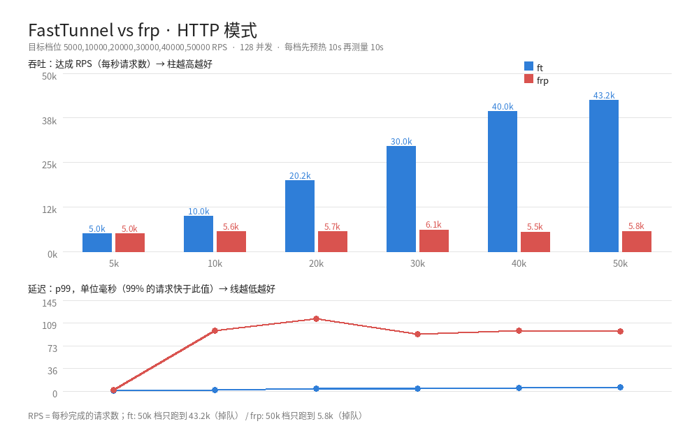
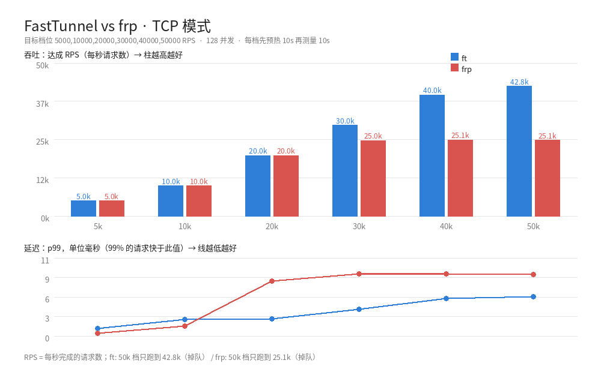

# 公众号推文：内网穿透性能实测（更新版）

> 标题备选（按"敢下结论"排序，主推第 1 个）：
> 1. 《frp 跑到 10K 就崩了：43K vs 33K，我把两个内网穿透按在同一台机器上压爆》
> 2. 《别再吹 Go 快了——同一个 frp，换个 type 就从 10K 掉到 5K》
> 3. 《90 万次请求压测，我给 frp 找出一个上游 bug，也给自己找出一个》
> 4. 《内网穿透的真相：瓶颈不在语言，不在平台，在你没看的那一层》
> 5. 《43K RPS 对 33K：这次不是玄学，是可复现的压测》



---

> **版本说明（重要）**：本文测的 FastTunnel 是 **v3 分支的优化版本**
> （mux 重写、管道泵、计量快路径等），已随 v3.4.0 发布；
> 本文数字来自该分支的源码构建，与官方 v3.4.0 包同一份代码。
> frp 为 0.72.0 官方二进制。

## 一、先说结论

我把两个内网穿透项目放在**同一台机器、同一个源站、同一套压测工具**下对照：

- **FastTunnel**（.NET，多路复用的自研 mux）
- **frp 0.72.0**（Go，社区最流行的方案）

两个结论比较反直觉：

1. **Go 不慢，frp 的转发内核也不慢。** 换成 `type=tcp` 纯转发，它在 10K RPS 下只比 FastTunnel 低一点，尾延迟差 2ms 量级。
2. **frp 真正扛不住的，是它的 HTTP 模式。** 同一份二进制，只把 `type=tcp` 改成 `type=http`，10K RPS 下吞吐直接掉到 5.4K、p99 从 7ms 涨到 100ms 以上。

一句话：**慢的不是语言，是 HTTP vhost 那条路径。**

---

## 二、测试怎么做的

为了不被"配置差异"和"机器差异"误导，做了几件事：

| 项目 | 处理 |
|---|---|
| 源站 | 本机 IIS/Kestrel 上的静态页（1KB），无外部依赖 |
| 域名 | 改 hosts：`bench.ftbench.net` / `bench.frpbench.net` → 127.0.0.1 |
| 加密 | **两侧都关 TLS**（FastTunnel `Tls.Enabled=false` + `ws`；frp `transport.tls.enable=false`） |
| 日志 | **两侧都压到最低**（FastTunnel Serilog `Fatal`；frp `log.level=error`、`log.to=disable`） |
| 压测 | 自写开环定速工具：精确到每秒发多少请求，逐请求记延迟，可指定 Host 头 |
| 公平性 | 每一档**先预热 10s 再测量 10s**，两条链路**同轮交替**跑，避免机器漂移 |
| 采集 | 吞吐、错误率、p50/p99/p99.9、两侧进程 CPU、内存（私有字节） |

压测工具和脚本全部开源：**https://github.com/FastTunnel/fasttunnel-bench**

---

## 三、第一个发现：frp 的 HTTP 模式会塌

同一台 16 核 Windows、256 并发，目标 10K RPS：

| 配置 | 达成 RPS | 错误率 | p99 |
|---|---|---|---|
| FastTunnel（HTTP 穿透） | **9992** | **0%** | **5ms** |
| frp `type=tcp` | 9997 | 0% | 7.6ms |
| frp `type=http` | 7781 | **2.8%** | **397ms** |

差异不在吞吐数字本身，而在**尾延迟和错误率**：同样的 1 万次请求，FastTunnel 最慢的 1% 是 5ms，frp 的 HTTP 模式是 397ms、还有 2.8% 失败。

翻 frp 的 debug 日志找到了原因：

```
5 秒内 12 510 个请求完成
frps 记录 "new work connection registered" 12 891 次
```

**平均每个请求都在新建一条 work connection**——本该复用的连接退化成了每次握手拨号。

> 这里要澄清一个常见误解：frp 0.72 默认已经开了 mux（日志里能看到 `accept new mux stream`），
> 所以不是"每条连接新 TCP"那种问题；问题出在 HTTP vhost 层对 work connection 的复用策略。

另外提醒一句：frp 的 `transport.poolCount` 默认只有 **5**。压 256 并发时不调大，等于让每条连接现场拨号，
你会测出"frp 只能跑 1.4K RPS"这种错误结论（实测把 poolCount 调平到 256，同一档从 1435 RPS/84% 错误变成 4941 RPS/0.58% 错误）。

---

## 四、第二个发现：纯 TCP 转发，两家其实很接近

把 frp 换成 `type=tcp`、FastTunnel 换成端口转发，同样是逐档加速：

| 目标 RPS | FastTunnel 达成 / p99 | frp(tcp) 达成 / p99 |
|---|---|---|
| 5 000 | 4 984 / 0.89ms | 4 983 / 1.11ms |
| 10 000 | 9 970 / 1.55ms | 9 968 / 2.08ms |
| 30 000 | 29 948 / 3.70ms | 29 921 / 5.31ms |
| 60 000 | **42 693** / 5.68ms | 33 865 / 7.46ms |
| 90 000 | **43 138** / 5.63ms | 33 052 / 7.52ms |

- 30K 以内两家都能精确吃满目标、0 错误；
- 真正的分水岭在 60K 以后：FastTunnel 顶到 **43K**，frp 停在 **33K**，差 25%~30%；
- 内存上 frp 更省（纯转发 60~100MB vs FastTunnel 170~220MB）。

所以如果你只用 TCP 转发，两者都能用；**要到"高并发 HTTP 穿透"这个场景，差距才被放大。**

---

## 五、第三个发现：我在 CI 上踩到的 Linux 坑（顺手修了）

既然主战场是 Linux，我把整套压测搬到了 GitHub Actions 的 `ubuntu-latest` 上。结果一上来全部失败，
排下来发现一个**真实的上游 bug**：

FastTunnel 的监听端口 `BinPort` 不是写在 `Program.cs`，而是挂在一个 `IHostingStartup` 里：

```csharp
// FastTunnel.Hosting/FastTunnelHostingStartup.cs
builder.UseKestrel((context, options) => {
    var basePort = context.Configuration.GetValue<int?>("FastTunnel:BinPort") ?? 1270;
    options.ListenAnyIP(basePort, lo => lo.UseConnectionFastTunnel());
});
```

在 Linux 上这个 hosting startup 没被加载，Kestrel 就退回默认端点 `[::1]:5000`——
表现就是：**进程活着、日志正常、但 17270 根本没监听**，客户端只会报 "Unable to connect"。
Windows 上恰好能加载，所以这个 bug 一直没暴露。

修法是把绑定显式放到 `Program.cs`（与平台无关），并去掉 hosting startup 里的重复绑定。

顺手还发现上游 `v3` 分支**编译不过**：某个优化提交引用了 `PipePumps`，但 `PipePumps.cs` 没提交。

---

## 六、在 CI 上的实测（4 核共享 runner）



HTTP 模式，128 并发，每档预热 10s + 测量 10s：

| 目标 RPS | FastTunnel 达成 / p99 | frp(http) 达成 / p99 |
|---|---|---|
| 5 000 | 4 999 / 1.05ms | 4 035 / 239ms |
| 10 000 | 9 999 / 5.69ms | 4 040 / 131ms |
| 20 000 | 19 985 / 6.88ms | 4 103 / 111ms |
| 30 000 | 27 499 / 9.92ms | 3 853 / 136ms |
| 40 000 | 28 562 / 8.61ms | 3 965 / 165ms |
| 50 000 | 28 822 / 8.78ms | 3 831 / 157ms |

4 核的机器上，FastTunnel 顶在 ~29K RPS，frp 的 HTTP 模式从头到尾卡在 ~4K、p99 100ms 以上——
**六个档位都指向同一个瓶颈，跟 Windows 16 核上的结论完全一致。**

---

## 七、这些数字该怎么看（重要）

1. **不要拿绝对数字跨机器比较。** 单机 loopback、共享 vCPU、4 核 vs 16 核，差异很大。
2. **看懂两个方向**：柱状是**吞吐（RPS，每秒请求数，越高越好）**，折线是**延迟（p99 毫秒，越低越好）**。
3. **看"谁先掉队"而不是"谁峰值高"**：达成速率停止跟随目标 + p99 抬升，就是到达上限的信号。
4. **配置对齐再下结论**：TLS、日志、`poolCount`、代理类型（http 对 http、tcp 对 tcp）必须一致。

---

## 八、自己复现

```bash
git clone https://github.com/FastTunnel/FastTunnel.git
git clone https://github.com/FastTunnel/fasttunnel-bench.git
cd fasttunnel-bench

# HTTP 模式：FastTunnel Web vs frp type=http
bash bench/exp/bench.sh http  --levels 5000,10000,20000,30000 --connections 128

# TCP 模式：FastTunnel Forwards vs frp type=tcp
bash bench/exp/bench.sh tcp   --levels 5000,10000,20000,30000 --connections 128
```

每次跑完会自动生成图表和 Markdown 报告；CI 里则自动发一条 issue 存档，方便对比历史。

---

## 九、写在最后

这次实测最想说的不是"谁比谁快"，而是：

> **性能问题常常不在你以为的那一层。**
> 语言（Go vs .NET）不是这里的瓶颈，HTTP vhost 的连接复用策略才是；
> 平台（Windows vs Linux）也不是，而是那段只在 Windows 生效的启动逻辑。

如果你也在做穿透/代理类的基础设施，建议先量三件事：**尾延迟、错误率、连接复用率**——
峰值吞吐往往是最会骗人的那个指标。

*压测工具、脚本、原始数据、图表全部开源，欢迎复现与挑错：*
*https://github.com/FastTunnel/fasttunnel-bench*
